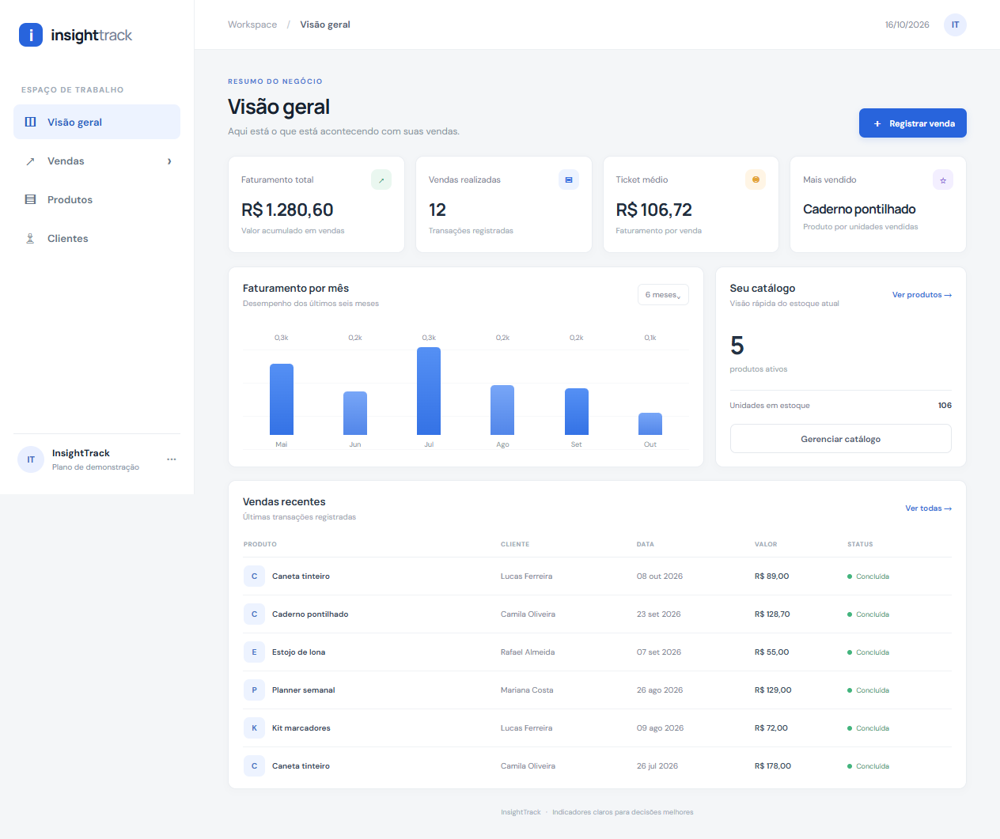
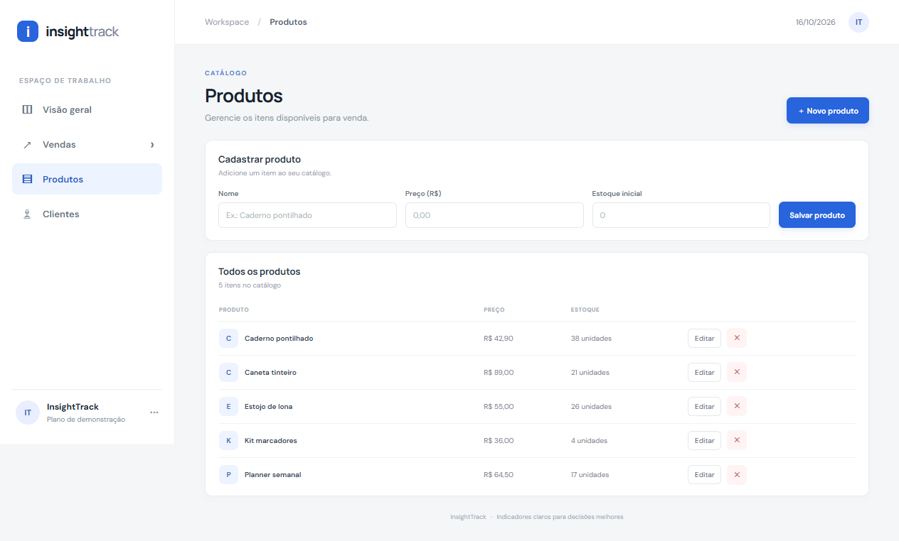
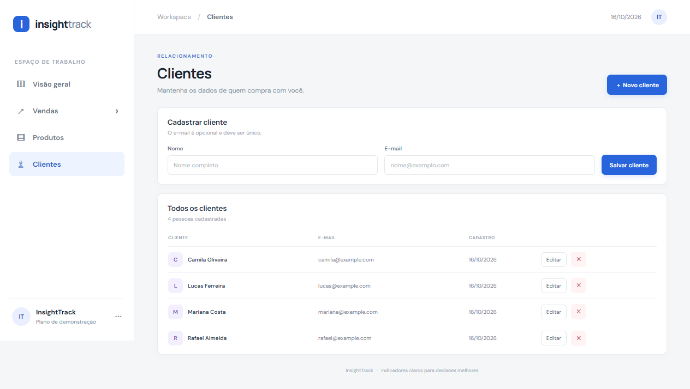
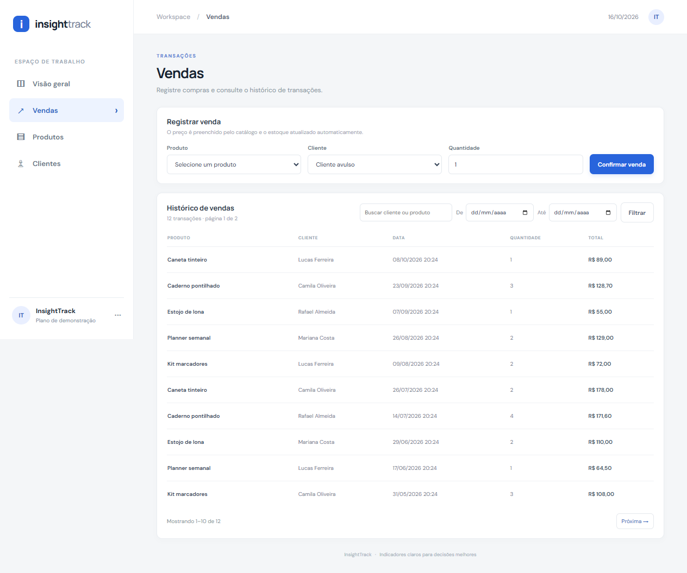
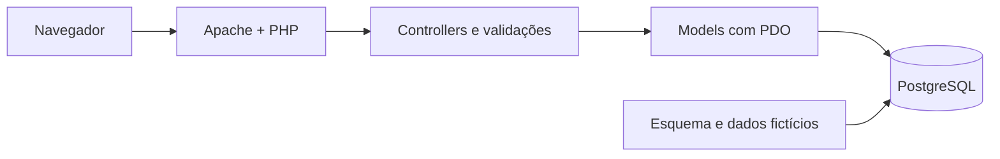

# InsightTrack

Aplicação web de controle de vendas e indicadores para uma pequena loja. O projeto demonstra PHP com PDO, PostgreSQL, consultas analíticas e execução reproduzível com Docker Compose.

Cada venda contém um produto para manter o MVP simples. O preço é copiado para o registro da venda e o estoque é reduzido ao confirmar a transação.

## Capturas de tela

As telas usam dados fictícios:









## Pré-requisitos

Para iniciar o sistema, instale:

1. **Docker Desktop**, que inclui Docker Compose. No Windows, siga o [guia oficial de instalação](https://docs.docker.com/desktop/setup/install/windows-install/) e inicie o Docker Desktop antes de usar o terminal.
2. **O código do InsightTrack**: baixe o ZIP pelo botão **Code → Download ZIP** na página do repositório e extraia a pasta. Se preferir clonar pelo terminal, instale o [Git for Windows](https://git-scm.com/install/windows) e use o comando abaixo, substituindo a URL pela URL deste repositório:

   ```powershell
   git clone https://github.com/SEU-USUARIO/insighttrack.git
   ```

PHP, Apache, PostgreSQL, Node.js e Docker Compose não precisam ser instalados separadamente: a imagem e os contêineres do Docker fornecem o ambiente da aplicação. Para executar os testes unitários diretamente no Windows, instale PHP 8.4; alternativamente, rode-os dentro do contêiner conforme a seção [Testes](#testes).

## Iniciar no Windows

1. Abra o Docker Desktop e aguarde o estado **Engine running**.
2. Abra o PowerShell na pasta extraída/clonada do projeto. Essa pasta deve conter `compose.yaml`. No Explorador de Arquivos, entre nela, clique na barra de endereço, digite `powershell` e pressione Enter.
3. Opcionalmente, crie sua configuração local copiando o exemplo:

   ```powershell
   Copy-Item .env.example .env
   ```

   O exemplo já funciona para desenvolvimento local. Se mudar uma porta ou credencial no `.env`, use os mesmos valores durante todo o ambiente. Não publique o `.env`.

4. Construa e inicie a aplicação e o banco:

   ```powershell
   docker compose up --build -d
   ```

   Na primeira execução, o Docker baixa as imagens do PHP e do PostgreSQL, constrói o contêiner da aplicação e cria o banco com dados de demonstração. Isso pode levar alguns minutos.

5. Confira se os dois serviços estão ativos:

   ```powershell
   docker compose ps
   ```

6. Abra [http://localhost:8080](http://localhost:8080) no navegador.

Para acompanhar os logs durante a inicialização:

```powershell
docker compose logs -f app db
```

Pressione `Ctrl+C` para sair da visualização dos logs. Para parar os contêineres sem apagar os dados:

```powershell
docker compose down
```

Depois, `docker compose up -d` inicia novamente o ambiente preservado.

## Portas e configuração local

O arquivo `.env.example` define as portas e credenciais de desenvolvimento:

| Variável | Padrão | Uso |
| --- | --- | --- |
| `APP_PORT` | `8080` | Porta do site no navegador |
| `DB_PORT` | `5432` | Porta do PostgreSQL acessível pelo computador |
| `POSTGRES_DB` | `insighttrack` | Banco criado no PostgreSQL |
| `POSTGRES_USER` | `insighttrack` | Usuário do banco |
| `POSTGRES_PASSWORD` | `insighttrack_dev` | Senha local de demonstração |

Essas credenciais são apenas para desenvolvimento local; troque-as antes de usar o projeto em um ambiente compartilhado. Se a porta `8080` já estiver ocupada, altere `APP_PORT` no `.env` (por exemplo, `8081`) e acesse a nova porta. Se a porta `5432` estiver ocupada, escolha outra para `DB_PORT`.

## Como o sistema funciona

1. O navegador abre uma página do painel. A aplicação PHP recebe a solicitação pelo Apache e consulta o PostgreSQL usando PDO.
2. Para cadastrar ou editar dados, o formulário envia uma solicitação POST com um token CSRF. O controller chama as validações e depois o model executa SQL parametrizado.
3. Ao registrar uma venda, o sistema inicia uma transação, bloqueia a linha do produto enquanto confere o estoque, grava a venda com o preço vigente e desconta a quantidade. Se qualquer etapa falhar, a transação é revertida e o estoque não muda.
4. O histórico permite buscar por cliente ou produto, filtrar por datas e navegar dez registros por página.
5. O dashboard agrega os dados no PostgreSQL para mostrar faturamento, número de vendas, ticket médio, produto mais vendido, receita mensal e vendas recentes.

O banco tem três entidades principais: clientes, produtos e vendas. Um cliente é opcional (venda avulsa); produto e quantidade são obrigatórios. O script de inicialização cria essas tabelas e insere registros fictícios somente quando o volume do banco é criado pela primeira vez.

### Primeiro uso

O painel já abre com vendas fictícias. Para testar o fluxo completo, abra **Produtos** e cadastre ou edite um item, abra **Clientes** e cadastre uma pessoa, depois entre em **Vendas**, escolha o produto, cliente e quantidade e confirme. A venda aparece no histórico; o preço vem do catálogo e o estoque diminui automaticamente. Use a busca e os campos **De/Até** para filtrar o histórico.



### Módulos

- **Configuração:** cria e reutiliza a conexão PDO a partir das variáveis de ambiente.
- **Controllers:** coordenam cadastros, edições, remoções, vendas, filtros e paginação.
- **Models:** concentram SQL e persistência de produtos, clientes, vendas e indicadores.
- **Validação:** verifica nomes, e-mails, preços, estoque, quantidade e datas antes de acessar o banco.
- **Banco:** contém o esquema e dados iniciais de demonstração. As consultas analíticas respondem perguntas de negócio sobre receita mensal, produtos, clientes, variação mensal e estoque baixo.

O arquivo de análise reúne cinco exemplos de SQL para estudo de agregações, `DATE_TRUNC`, `LAG`, `FILTER`, junções e funções de janela.

## Testes

Com PHP 8.4 instalado no Windows, execute os testes de validação:

```powershell
php tests/run.php
```

Ou, com o serviço iniciado, execute a mesma suíte dentro do contêiner:

```powershell
docker compose exec app php /var/www/tests/run.php
```

Os testes de integração usam o PostgreSQL local e verificam edição de produtos e clientes, preço histórico, baixa de estoque, recusa de venda acima do estoque, rollback e paginação:

```powershell
docker compose exec app php /var/www/tests/integration.php
```

## Dados e solução de problemas

- `docker compose down` para os serviços e mantém o banco.
- `docker compose down -v` também remove o volume do PostgreSQL **e apaga todos os dados salvos**. Use isso somente se quiser recriar o banco de demonstração do zero; então execute `docker compose up --build -d` novamente.
- Se o site não abrir, confira se o Docker Desktop está iniciado, veja o estado com `docker compose ps` e consulte os logs com `docker compose logs app db`.
- Se o Compose reclamar que uma porta está em uso, ajuste `APP_PORT` ou `DB_PORT` no `.env` e inicie de novo.
- Se tabelas ou dados não corresponderem ao script de inicialização, o volume existente já foi inicializado antes. Para recarregar o esquema de demonstração, siga o aviso destrutivo sobre `docker compose down -v` acima.

## Exemplo de descrição para currículo

**InsightTrack — Controle de Vendas e Indicadores** · Projeto pessoal

Desenvolvi uma aplicação web com PHP 8.4, PDO e PostgreSQL para gerenciar produtos, clientes e vendas. Implementei operações CRUD, validação de estoque com transações, histórico paginado com filtros e um dashboard com indicadores comerciais. Estruturei as consultas e regras em models e controllers, preparei consultas SQL para análise de receita e configurei o ambiente com Docker Compose.

**Tecnologias:** PHP, PDO, PostgreSQL, SQL, Docker, Docker Compose, HTML e CSS.
